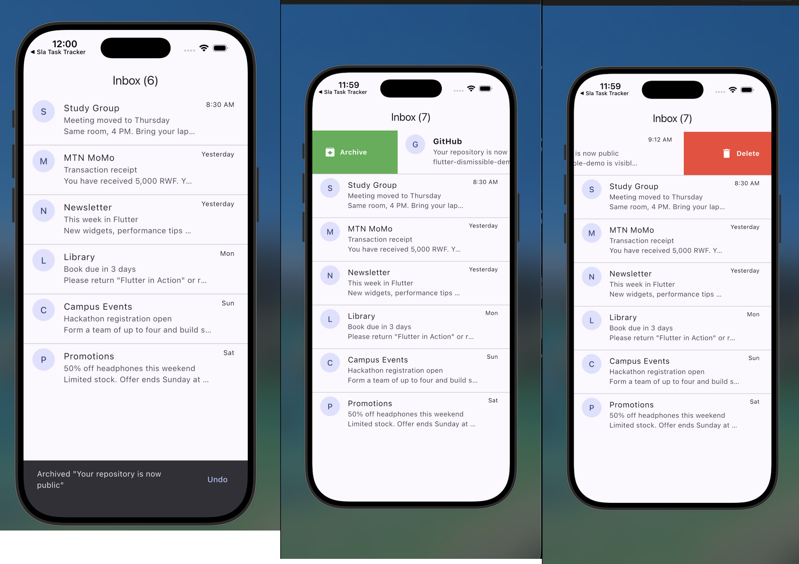

# Flutter Dismissible Demo

`Dismissible` is a Flutter widget that lets you swipe items away instead of tapping a button to remove them. You've probably seen this in email apps or to-do lists.


## The idea

For this demo, I built a simple email inbox where you can swipe emails in either direction. Swiping right archives an email, shown with a green background, while swiping left deletes it, shown in red.

If you swipe an email by mistake, you can bring it back using the Undo button in the snackbar at the bottom.

I chose an inbox because it's a familiar example, so you can see how `Dismissible` works without needing a complicated app. I also added a settings panel to let you change three of its properties and see what happens immediately.

## How to run it

You'll need Flutter installed. I used Flutter 3.47.2 for this project.

```bash
git clone https://github.com/intwaza/flutter-dismissible-demo

cd flutter-dismissible-demo

flutter pub get

flutter run -d chrome
```

To run it on the iOS simulator, open the simulator first and then start the app:

```bash
open -a Simulator

flutter run -d "iPhone 17 Pro"
```

Once the app is running, drag an email to the left or right to archive or delete it. The tune icon in the top-right corner opens the settings panel, where you can change the three properties while the app is running. If you want to start over, use the refresh icon to restore the emails.

## The three properties

The settings panel also has a **Flutter defaults** button. This resets the properties to their default values so you can compare the different behaviours.

### 1. `direction`

**Default:** `DismissDirection.horizontal`

This controls which directions an item can be swiped in. By default, you can swipe both left and right.

In the settings panel, you can change this to `endToStart`, which only allows swiping from right to left. Trying to swipe in the other direction won't dismiss the item.

**Why it matters:** Not every list needs two swipe actions. For example, if the only action is deleting an item, allowing swipes in both directions might cause confusion or accidental gestures.

### 2. `background`

**Default:** `null`

This controls what appears behind an item as you swipe it away. If you don't set a background, there's no coloured panel to show what will happen.

In this demo, the `background` property displays a green Archive panel, while `secondaryBackground` displays a red Delete panel for the opposite direction.

One thing to keep in mind is that Flutter requires `background` to be set before you can use `secondaryBackground`.

**Why it matters:** Showing the action while someone is swiping makes it easier to understand what will happen before they release the item.

### 3. `dismissThresholds`

**Default:** `0.4` (40% of the item's width)

This controls how far an item needs to be dragged before it can be dismissed. If you release it before reaching the threshold, it moves back to its original position.

In the settings panel, you can adjust the threshold from 20% to 80%. At 20%, a shorter swipe can dismiss an item. At 80%, you have to drag it much further.

**Why it matters:** The distance needed to dismiss an item affects how easy it is to trigger the action. A higher threshold can help reduce accidental deletions, while a lower one makes swiping quicker.

## Where to find the code

* `lib/screens/inbox_screen.dart` contains the inbox and the `Dismissible` widget. I've marked the three properties with `PROPERTY 1`, `PROPERTY 2`, and `PROPERTY 3` comments.
* `lib/widgets/settings_panel.dart` contains the controls for changing the properties while the app is running.
* `lib/widgets/swipe_background.dart` contains the green Archive and red Delete panels.
* `lib/data/sample_emails.dart` contains the sample email data used in the inbox.

## References

* [Flutter Dismissible documentation](https://api.flutter.dev/flutter/widgets/Dismissible-class.html)
* [Flutter cookbook: Implement swipe to dismiss](https://docs.flutter.dev/cookbook/gestures/dismissible)
